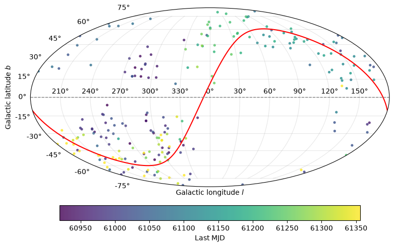
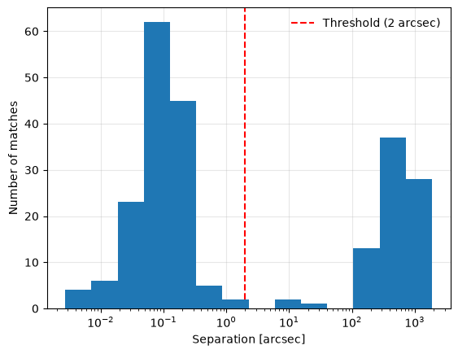
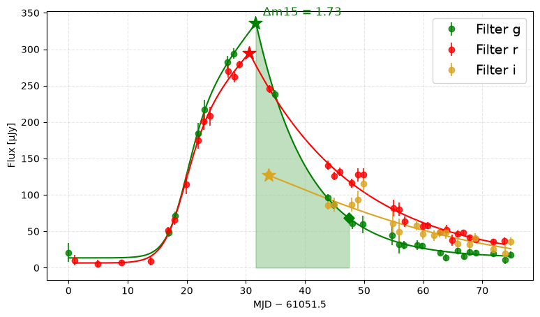
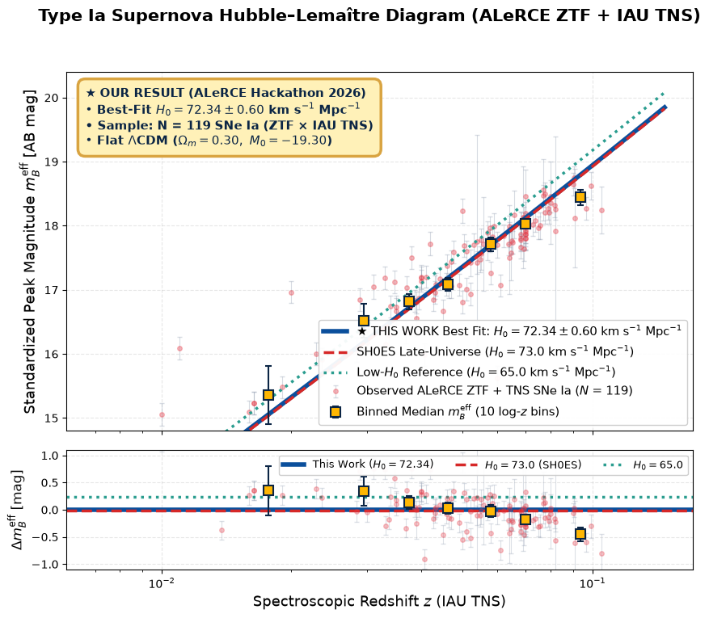
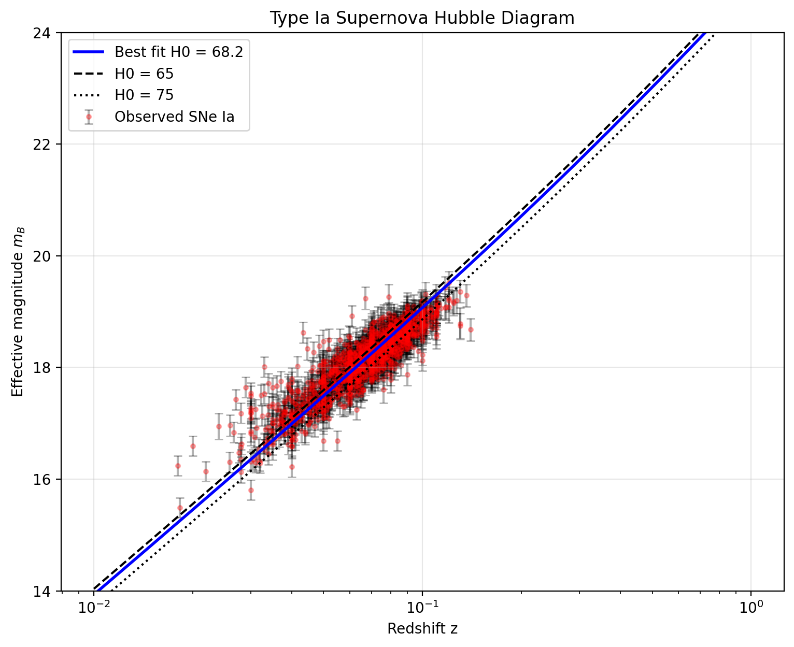
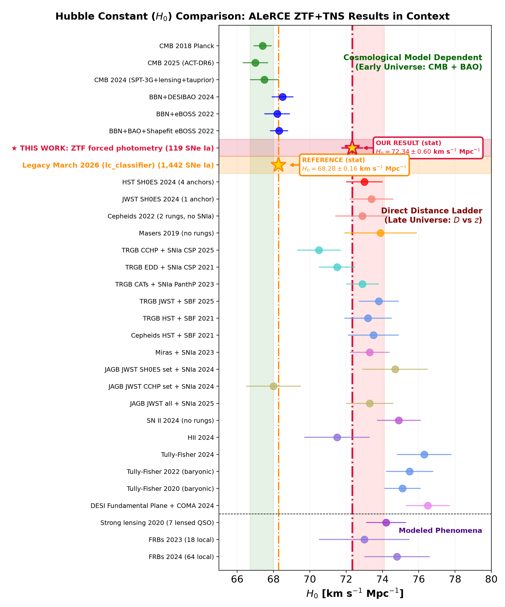
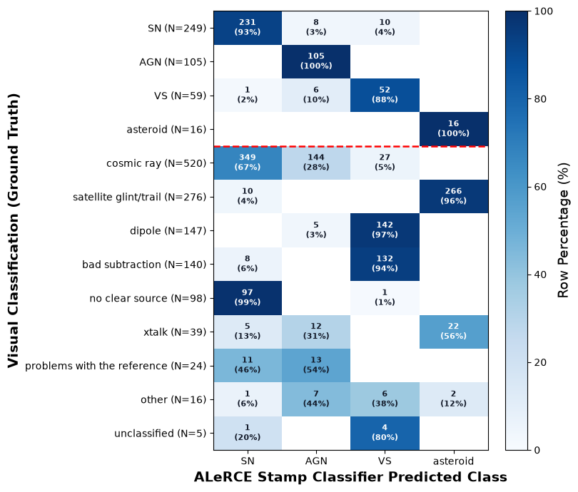
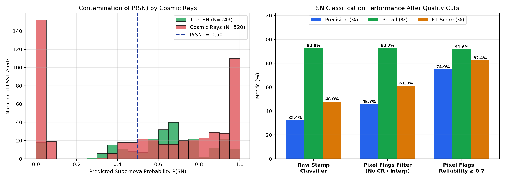

# ALeRCE-ZTFLSST-HubbleConstant: Cosmological $H_0$ Inference from ZTF Type Ia Supernovae & Early LSST Alert Vetting

[](https://science.alerce.online/)
[](https://science.alerce.online/)
[](https://alerce.online/)
[](https://sncosmo.readthedocs.io/)
[](https://www.wis-tns.org/)

**Authors:** [Steve Jurado](https://github.com/jurados) ([@jurados](https://github.com/jurados)) & [Xaviera Julio](https://github.com/Xavissss) ([@Xavissss](https://github.com/Xavissss))  
**Event & Context:** Developed during the **[ALeRCE Hackathon 2026](https://science.alerce.online/)** (*Automatic Learning for the Rapid Classification of Events* — [https://science.alerce.online/](https://science.alerce.online/))  
**Date / Last Updated:** November 2026 (pipeline refactor in `ALeRCE_Hackathon.ipynb`; original analysis March 2026)

---

## Overview

**`ALeRCE-ZTFLSST-HubbleConstant`** is an observational cosmology and time-domain project started during the **March 2026 ALeRCE Hackathon**. It standardizes **Zwicky Transient Facility (ZTF)** Type Ia supernovae (SNe Ia) classified by the **ALeRCE** broker, using spectroscopic redshifts from the **IAU Transient Name Server (TNS)**, and fits a Hubble diagram to estimate $H_0$. It also audits the **ALeRCE Stamp Classifier** on early **Rubin/LSST** alerts.

Everything lives in one notebook, **`ALeRCE_Hackathon.ipynb`**:

1. **Forced-photometry pipeline (new).** Recent SN Ia candidates from the forced-photometry classifier are matched to TNS, their light curves are fit with the **Villar et al. (2019)** model to get the peak magnitude and the decline rate $\Delta m_{15}(g)$, and they are standardized to the rest-frame $B$ band (Phillips relation).
2. **Legacy March 2026 sample.** A larger earlier sample ($N = 1{,}442$) from the legacy `lc_classifier`, kept as a reference (originally `alerce.ipynb`, now in git history).
3. **LSST audit.** The Stamp Classifier is benchmarked on **1,694** visually labeled LSST alerts, and the LSST supernovae are searched for ZTF counterparts.

---

## Key Results

| Result | Value | Notes |
| :--- | :--- | :--- |
| ZTF SN Ia candidates | $288 \to 229$ | `lc_classifier_BHRF_forced_phot`, $P \ge 0.59$, then `lastmjd >= 60918` |
| With a TNS counterpart | **147** | Sky match within $2''$ |
| $\Delta m_{15}(g)$ measured | **122** (119 with errors) | Villar (2019) fit, $\ge 10$ $g$-band points |
| **$H_0$, forced photometry** ($N=119$) | **$72.37 \pm 0.60$** km s$^{-1}$ Mpc$^{-1}$ (stat) | $\chi^2/\mathrm{dof} = 5.21$ |
| **$H_0$, legacy March 2026** ($N=1{,}442$) | **$68.28 \pm 0.16$** km s$^{-1}$ Mpc$^{-1}$ (stat) | $\chi^2/\mathrm{dof} = 2.57$; originally quoted as $68.16 \pm 0.16$ without the peculiar-velocity term |
| LSST Stamp Classifier, `SN` recall | **93 %** (231 / 249) | Precision only **32.4 %** on the raw output |
| …after pixel-flag and reliability cuts | precision **74.9 %**, recall **91.6 %**, F1 **82.4 %** | Cuts chosen on the same data (no held-out set) |
| ZTF counterparts of LSST supernovae | **none** | See Section 7.3 |

**How to read the two $H_0$ values.** They are **not** independent measurements of the Hubble constant:

- The absolute magnitude is fixed at $M_0 = -19.3$, and $H_0$ and $M_0$ are degenerate (Section 6.2). The quoted errors are statistical only.
- The two samples differ by $5\log_{10}(72.37/68.28) \approx 0.13$ mag in their mean standardized magnitude. Because $M_0$ is fixed, that offset alone produces the 4 km s$^{-1}$ Mpc$^{-1}$ difference.
- $\chi^2/\mathrm{dof}$ of 5.2 and 2.6 mean the errors are underestimated. Scaling them by $\sqrt{\chi^2/\mathrm{dof}}$ gives $\pm 1.4$ and $\pm 0.26$, and the difference drops from ~6.5σ to ~3σ.

---

## 1. Scientific Motivation & The $H_0$ Tension

Type Ia supernovae are thermonuclear explosions of carbon–oxygen white dwarfs and **standardizable candles**. Modern cosmology faces a persistent $\sim 5\sigma$ disagreement, the **Hubble Tension**, between:

- **Early-Universe / CMB + BAO constraints** (flat $\Lambda\mathrm{CDM}$): *Planck* 2018 gives $H_0 = 67.4 \pm 0.5\,\mathrm{km\,s^{-1}\,Mpc^{-1}}$; ACT-DR6 2025 gives $67.0 \pm 0.7$; BBN + DESI BAO 2024 gives $68.5 \pm 0.6$.
- **The late-Universe distance ladder**, calibrated with Cepheids and the Tip of the Red Giant Branch (TRGB): HST SH0ES 2024 gives $73.0 \pm 1.0$; JWST SH0ES 2024 gives $73.4 \pm 1.2$.

Surveys are moving from ZTF ($\sim 10^6$ alerts/night) to the **Vera C. Rubin Observatory LSST** ($\sim 10^7$ alerts/night), so SN Ia samples are increasingly selected in real time by brokers such as **[ALeRCE](https://science.alerce.online/)**. This project connects **automated broker classification** with **cosmological inference**.

---

## 2. Pipeline

```text
┌──────────────────────────────────────────────────────────────────────────────┐
│          STAGE 1: BROKER QUERY & TNS CROSS-MATCHING                          │
│  ALeRCE ZTF lc_classifier_BHRF_forced_phot (class='SNIa', p >= 0.59)         │
│  ──► 288 candidates ──► lastmjd >= 60918 (1 Sep 2025) ──► 229 candidates     │
│  ──► sky match vs. IAU TNS (191,101 objects, sep <= 2.0 arcsec)              │
│  ──► 147 candidates with a TNS counterpart                                   │
└──────────────────────────────────────┬───────────────────────────────────────┘
                                       ▼
┌──────────────────────────────────────────────────────────────────────────────┐
│          STAGE 2: PHOTOMETRY & LIGHT-CURVE FITTING                           │
│  detections + non-detections + forced photometry  ──►  data/*.parquet        │
│  Villar et al. (2019) flux model per band (g, r, i), fit in μJy              │
│  ──► peak epoch, m_peak_g and rest-frame Δm15(g) with Monte-Carlo errors     │
│  ──► Δm15 measured for 122 objects (119 with uncertainties)                  │
└──────────────────────────────────────┬───────────────────────────────────────┘
                                       ▼
┌──────────────────────────────────────────────────────────────────────────────┐
│           STAGE 3: PHILLIPS STANDARDIZATION TO REST-FRAME B BAND             │
│  • Stretch:  s = 1.24 - 0.18 * Δm15  (α = 0.60)                              │
│  • Dust:     SFD98 E(B-V) from IRSA (R_g = 3.2)                              │
│  • K-corr.:  sncosmo Hsiao SN Ia template (sdssg -> bessellb)                │
│  ──► mB_eff ± dmB_eff  (N = 119 forced photometry; N = 1,442 March 2026)     │
└──────────────────────────────────────┬───────────────────────────────────────┘
                                       ▼
┌──────────────────────────────────────────────────────────────────────────────┐
│           STAGE 4: HUBBLE DIAGRAM & FLAT ΛCDM χ² FIT (H0)                    │
│  m_model(z; H0, Ωm=0.30) = M0 (-19.3) + μ  ──►  H0 per sample                │
└──────────────────────────────────────┬───────────────────────────────────────┘
                                       ▼
┌──────────────────────────────────────────────────────────────────────────────┐
│             STAGE 5: LSST STAMP CLASSIFIER AUDIT                             │
│  1,694 visually labeled LSST alerts ──► confusion matrix & quality cuts      │
│  74 LSST SNe ──► search for ZTF / TNS counterparts (none found)              │
└──────────────────────────────────────────────────────────────────────────────┘
```

---

## 3. Stage I — ALeRCE ZTF Query & TNS Cross-Matching

Candidates are queried with the ALeRCE Python client (`alerce.core.Alerce`) using the forced-photometry Balanced Hierarchical Random Forest classifier `lc_classifier_BHRF_forced_phot`: class `SNIa`, $P(\mathrm{SNIa}) \ge 0.59$, ordered by `lastmjd`. This returns **288 objects**. Keeping only sources active after **1 September 2025** (`lastmjd >= 60918`) leaves **229 recent candidates**.

<p align="center">
  
</p>

*Mollweide projection in Galactic coordinates of the candidates, colored by last detection MJD. The red curve is the ecliptic and the dashed line is the Galactic plane. Candidates avoid the Galactic plane, as expected for extragalactic transients.*

Each position is matched to the **IAU TNS public catalog** (191,101 objects) with `SkyCoord.match_to_catalog_sky`, which finds the nearest neighbor with a KD-tree on unit vectors in $\mathcal{O}(N\log M)$.

<p align="center">
  
</p>

The separation distribution is clearly bimodal: true counterparts cluster around $\sim 0.1''$ and unrelated nearest neighbors lie at $\gtrsim 100''$. A threshold of $\theta \le 2.0''$ gives **147 candidates with a TNS counterpart**, for which we attach `tns_name`, `tns_type`, `tns_redshift` and `tns_sep_arcsec`. Detections, non-detections and **forced photometry** of every candidate are downloaded and cached in `data/snia_{detections,non_detections,forced}.parquet`.

---

## 4. Stage II — Villar (2019) Light-Curve Fits & $\Delta m_{15}$

Light curves are fit in **flux space**. Forced-photometry AB magnitudes are converted to microjanskys with $F = 10^{-0.4\,(m - 23.9)}\,\mu\mathrm{Jy}$, with errors propagated as $\sigma_F = 0.4\ln(10)F\sigma_m$. Sentinel values ($m \ge 99$) and poor measurements ($\sigma_m \ge 1$) are discarded. Each band (`fid` = 1, 2, 3 → $g$, $r$, $i$) is fit with the empirical model of **[Villar et al. (2019)](https://scixplorer.org/abs/2019ApJ...884...83V/abstract)**, a sigmoidal rise followed by a linear plateau and an exponential decay:

$$F(t) = c + \begin{cases} 
\dfrac{A + \beta(t - t_0)}{1 + e^{-(t - t_0)/\tau_{\mathrm{rise}}}}, & t < t_1 \\ 
\dfrac{\left(A + \beta\gamma\right) e^{-(t - t_1)/\tau_{\mathrm{fall}}}}{1 + e^{-(t - t_0)/\tau_{\mathrm{rise}}}}, & t \ge t_1 
\end{cases} \qquad t_1 = t_0 + \gamma$$

The fit uses bounded `scipy.optimize.curve_fit` on the peak-normalized flux. The peak $t_{\mathrm{peak}}$ is the maximum of the fitted curve (not $t_0$). The **rest-frame decline rate** is measured $15(1+z)$ observer-frame days after the peak ([Phillips 1993](https://doi.org/10.1086/186970)):

$$\Delta m_{15} = m(t_{\mathrm{peak}} + 15) - m(t_{\mathrm{peak}}) = 2.5\log_{10}\frac{F(t_{\mathrm{peak}})}{F\left(t_{\mathrm{peak}} + 15\,(1+z)\right)}$$

<p align="center">
  
</p>

*Example: **`ZTF26aaebmad`** ($z_{\mathrm{TNS}} = 0.0520$). Forced-photometry fluxes in $g$, $r$ and $i$ with Villar fits; stars mark each band's peak. The shaded area spans the 15 rest-frame days after the $g$ peak and gives **$\Delta m_{15}(g) = 1.73$ mag**. As expected for SNe Ia, $g$ peaks first and declines faster than $r$ and $i$.*

The batch fit runs over every TNS-matched object with $\ge 10$ $g$-band points. A fit is rejected if the peak falls at the edge of the data or there are no data at $t_{\mathrm{peak}} + 15(1+z)$. Uncertainties come from **200 Monte-Carlo draws** from the fit covariance matrix. This gives **122 objects with $\Delta m_{15}$** (median $1.18$, $m_{\mathrm{peak},g}$ median $17.8$), of which 119 have finite uncertainties. The results are merged into `df_snia` as `tpeak_g`, `m_peak_g`, `dm_peak_g`, `dm15` and `ddm15`. Errors use the `d` prefix throughout: `dX` is the uncertainty of `X`.

---

## 5. Stage III — SN Ia Standardization ($m_B^{\mathrm{eff}}$)

Each peak $g$-band magnitude is converted to a rest-frame Bessel $B$-band effective magnitude:

$$m_B^{\mathrm{eff}} = m_{\mathrm{peak},g} + \alpha(s - 1) - K(z) - A_g$$

$$\sigma_{m_B^{\mathrm{eff}}} = \sqrt{\sigma_{m_{\mathrm{peak}}}^2 + (\alpha\,\sigma_s)^2 + \sigma_K^2 + \sigma_{A_g}^2 + \sigma_{\mathrm{int}}^2}$$

- **Stretch.** $s = a + b\,\Delta m_{15}$ with $a = 1.24$, $b = -0.18$, $\sigma_s = |b|\,\sigma_{\Delta m_{15}}$, and a width–luminosity slope $\alpha = 0.60$.
- **Galactic dust.** $A_g = R_g\,E(B-V)_{\mathrm{SFD}}$ with $R_g = 3.2$ and $\sigma_{A_g} = 0.10\,A_g$. $E(B-V)$ is the Schlegel, Finkbeiner & Davis (1998) value queried from IRSA (`astroquery`) and cached.
- **K-correction.** Computed with `sncosmo` on the Hsiao et al. (2007) template at peak, as the difference between the `sdssg` and `bessellb` magnitudes of the model redshifted to $z$, with $\sigma_K = 0.02$ mag. This is an **approximation** to the standard K-correction: in a test it differed by $\lesssim 0.06$ mag at $z \le 0.14$.
- **Intrinsic dispersion.** $\sigma_{\mathrm{int}} = 0.17$ mag is added in quadrature and is **already included** in `dmB_eff`.

---

## 6. Stage IV — Hubble–Lemaître Diagram & $\chi^2$ Fit of $H_0$

In a flat $\Lambda\mathrm{CDM}$ universe with $\Omega_m = 0.30$:

$$m_{\mathrm{model}}(z; H_0) = M_0 + 5\log_{10}\left(\frac{d_L(z; H_0, \Omega_m)}{\mathrm{Mpc}}\right) + 25,\qquad d_L = \frac{c(1+z)}{H_0}\int_0^z \frac{\mathrm{d}z'}{\sqrt{\Omega_m(1+z')^3 + 1 - \Omega_m}}$$

with the fiducial absolute magnitude fixed at $M_0 = -19.3$. $H_0$ is the value that minimizes

$$\chi^2(H_0) = \sum_i \left(\frac{m_{B,i}^{\mathrm{eff}} - m_{\mathrm{model}}(z_i; H_0)}{\sigma_i}\right)^2,\qquad \sigma_i^2 = \sigma_{m_B^{\mathrm{eff}},i}^2 + \left(\frac{5}{\ln 10}\frac{\sigma_v}{cz_i}\right)^2$$

where the last term is the peculiar-velocity error ($\sigma_v = 250$ km s$^{-1}$). The $1\sigma$ interval is the range where $\chi^2$ rises by 1. One point per SN (its peak) is used.

<p align="center">
  
</p>

*Forced-photometry sample ($N = 119$): $H_0 = 72.37 \pm 0.60$ (the value varies by about 0.03 between runs, because the $\Delta m_{15}$ uncertainties come from Monte-Carlo draws). Squares are medians in 10 log-$z$ bins. The bottom panel shows the residuals with respect to the best fit; the dashed and dotted lines are the offsets that $H_0 = 73$ and $65$ would imply.*

The binned residuals trend from about $+0.35$ mag at $z \approx 0.02$ to $-0.45$ mag at $z \approx 0.1$. A flat $\Lambda\mathrm{CDM}$ model with a free $H_0$ cannot absorb a trend with redshift. We have not investigated its origin.

### 6.1 Summary of the two fits

| | Forced photometry (this notebook) | Legacy March 2026 |
| :--- | :---: | :---: |
| Unique SNe Ia, $N$ | $119$ | $1{,}442$ |
| $\Omega_m$, $M_0$ | $0.30$, $-19.3$ (fixed) | $0.30$, $-19.3$ (fixed) |
| $\sigma_{\mathrm{int}}$ | $0.17$ mag (fixed) | $0.17$ mag (fixed) |
| **Best-fit $H_0$** (km s$^{-1}$ Mpc$^{-1}$, stat) | **$72.37 \pm 0.60$** | **$68.28 \pm 0.16$** |
| $\chi^2/\mathrm{dof}$ | $5.21$ | $2.57$ |

<p align="center">
  
</p>

*Legacy March 2026 sample ($N = 1{,}442$), shown for reference.*

### 6.2 The $M_0$–$H_0$ degeneracy

Supernovae only measure relative distances: the data constrain the combination $M_0 - 5\log_{10}H_0$, so $H_0$ and $M_0$ cannot both be fit.

$$\frac{\Delta H_0}{H_0} \approx \frac{\ln 10}{5}\,\Delta M_0 \approx 0.46\,\Delta M_0 \quad\Rightarrow\quad \Delta M_0 = 0.05\ \mathrm{mag} \;\leftrightarrow\; \Delta H_0 \approx 1.6\ \mathrm{km\,s^{-1}\,Mpc^{-1}}$$

The Cepheid calibration of [Riess et al. (2022)](https://ui.adsabs.harvard.edu/abs/2022ApJ...934L...7R/abstract) gives $M_B = -19.253 \pm 0.027$. That uncertainty alone corresponds to $\sim \pm 0.9$ km s$^{-1}$ Mpc$^{-1}$, **about 5 times larger than the statistical error quoted above**. We did not find a single source for the rounded value $-19.3$ used here. The Riess et al. value was derived with a different standardization (Pantheon+), so it is not directly transferable to our $m_B^{\mathrm{eff}}$: using $M_0 = -19.253$ with the legacy sample gives $H_0 \approx 70$, not 73.

### 6.3 Placing the results in the Hubble-tension landscape

<p align="center">
  
</p>

*Both results against CMB/BAO, distance-ladder and modeled-phenomena determinations (literature values are approximate). That the forced-photometry value lies near SH0ES and the legacy value near Planck is a consequence of the zero-point and of $M_0$ being fixed. It is not evidence for either side of the tension.*

---

## 7. Stage V — LSST Stamp Classifier Audit

We audit the **ALeRCE Stamp Classifier** on **1,694 visually labeled LSST alerts** (1,471 unique objects; `data/classification_FF_20260309.csv`, visual classification by F. Förster). The predicted class is the $\arg\max$ of the five output probabilities (`SN`, `AGN`, `VS`, `asteroid`, `bogus`).

### 7.1 Confusion matrix

<p align="center">
  
</p>

Astrophysical classes are recovered well: **SN 93 %** (231/249), **AGN 100 %** (105/105), **VS 88 %** (52/59) and **asteroid 100 %** (16/16). The problem is the 1,265 artifacts (red dashed line separates them):

- **`bogus` is never the winning class.** In this data $P(\mathrm{bogus}) \le 0.48$ for every alert, so each artifact is forced into an astrophysical class.
- **Cosmic rays** (520) go mostly to `SN` (67 %, 349) and to `AGN` (28 %). Satellite trails go to `asteroid` (96 %), and dipoles and bad subtractions go to `VS` (97 % and 94 %).
- Of the **714** alerts predicted as `SN`, only 231 are real supernovae. 349 are cosmic rays and 97 are `no clear source`.

### 7.2 Quality cuts

<p align="center">
  
</p>

The left panel shows that $P(\mathrm{SN})$ alone cannot separate supernovae from cosmic rays: the latter pile up at $P \approx 1$ as well as at $P \approx 0$. Pixel flags and the real/bogus `reliability` score remove most of the contamination without losing completeness:

| Selection | Alerts | True SN kept | Precision | Recall | F1 |
| :--- | :---: | :---: | :---: | :---: | :---: |
| Raw Stamp Classifier | 1,694 | 231 | 32.4 % | 92.8 % | 48.0 % |
| No cosmic-ray / interpolated pixel flags | 1,274 | 230 | 45.7 % | 92.7 % | 61.3 % |
| + `reliability` $\ge 0.7$ | 755 | 185 | **74.9 %** | **91.6 %** | **82.4 %** |

The cuts were chosen on the same data used to evaluate them, so these numbers are optimistic until validated on a held-out sample. The sample is also dominated by artifacts (520 cosmic rays vs. 249 SNe), so precision depends on the real alert mix.

### 7.3 ZTF counterparts of the LSST supernovae: none

We cross-matched the **74 LSST objects** with visual class `SN` and $P(\mathrm{SN}) > 0.5$ against our ZTF sample and TNS to look for supernovae with light curves in both surveys. None was found:

| Catalog | $N$ | Minimum separation | $\le 10''$ |
| :--- | :---: | :---: | :---: |
| ZTF candidates (this notebook) | 229 | $7{,}293''$ | 0 |
| TNS SN Ia (all surveys) | 12,921 | $205''$ | 0 |

The reasons do not depend on the matching radius. The LSST supernovae are concentrated in a few fields (RA $\approx 150^\circ$, $\approx 187^\circ$ and $\approx 64^\circ$ / Dec $\approx -48^\circ$), while the ZTF sample covers the whole sky. The LSST catalog is a snapshot of about 11 days (MJD 61096–61107) with a **median of one detection per object**, so there is no light curve to compare. The only close pair, between the top-200 LSST SN candidates from the ALeRCE TAP and TNS, is at $4.1''$ from **SN 2021hiz** ($z = 0.0033$, discovered in 2021). That cannot be the same supernova as an alert from 2026. Finding a genuine counterpart would require a cone search over all ZTF objects, not only classified SNe Ia.

---

## 8. Known Limitations

- **$M_0$ is fixed and degenerate with $H_0$** (Section 6.2). Neither $H_0$ value is an independent measurement, and the quoted errors do not include the $M_0$ uncertainty.
- **Underestimated errors.** $\chi^2/\mathrm{dof} = 5.2$ and $2.6$. $\sigma_{\mathrm{int}}$ is fixed at 0.17 rather than fit, there is no color term in the standardization, and $\Omega_m$ is fixed.
- **Unexplained 0.13 mag offset** between the two samples. The original input data of the legacy sample are no longer in the repository, so the two pipelines cannot be compared directly.
- **Small forced-photometry sample** ($N = 119$) with a residual trend in $z$ (Section 6) of unknown origin.
- **Approximate K-correction** and a 10 % dust error assumed (Section 5).
- **LSST cuts evaluated in-sample** (Section 7.2), and the LSST sample is dominated by artifacts.

---

## 9. Next Steps

- Find the origin of the 0.13 mag offset: compare `mB_eff` for SNe present in both samples and review the differences between the two pipelines.
- Fit $\sigma_{\mathrm{int}}$ so that $\chi^2/\mathrm{dof} \simeq 1$, add a color term, and restrict the fit to $z \gtrsim 0.03$ to test the residual trend.
- Calibrate $M_0$ consistently with this standardization (for example with SNe in Cepheid hosts), and propagate its uncertainty into $H_0$.
- Validate the LSST quality cuts on a held-out sample.
- Cone-search all ZTF objects around the LSST supernova positions to look for genuine counterparts.

---

## 10. References

1. **Förster, F., Cabrera-Vives, G., Castillo-Navarrete, E., et al.** (2021), *"The Automatic Learning for the Rapid Classification of Events (ALeRCE) Alert Broker"*, The Astronomical Journal, 161, 242. [doi:10.3847/1538-3881/abe9bc](https://doi.org/10.3847/1538-3881/abe9bc) | [science.alerce.online](https://science.alerce.online/)
2. **Sánchez-Sáez, P., Reyes, I., Valenzuela, C., et al.** (2021), *"Alert Classification for the ALeRCE Broker System: The Light Curve Classifier"*, The Astronomical Journal, 161, 141. [doi:10.3847/1538-3881/abd5c1](https://doi.org/10.3847/1538-3881/abd5c1)
3. **Carrasco-Davis, R., Reyes, E., Valenzuela, C., et al.** (2021), *"Alert Classification for the ALeRCE Broker System: The Real-time Stamp Classifier"*, The Astronomical Journal, 162, 231. [doi:10.3847/1538-3881/ac0ef1](https://doi.org/10.3847/1538-3881/ac0ef1)
4. **Phillips, M. M.** (1993), *"The Absolute Magnitudes of Type IA Supernovae"*, The Astrophysical Journal Letters, 413, L105. [doi:10.1086/186970](https://doi.org/10.1086/186970)
5. **Hsiao, E. Y., Conley, A., Howell, D. A., et al.** (2007), *"K-Corrections and Spectral Templates of Type Ia Supernovae"*, The Astrophysical Journal, 663, 1187. [doi:10.1086/518232](https://doi.org/10.1086/518232)
6. **Schlegel, D. J., Finkbeiner, D. P., & Davis, M.** (1998), *"Maps of Dust Infrared Emission for Use in Estimation of Reddening and Cosmic Microwave Background Radiation Foregrounds"*, The Astrophysical Journal, 500, 525. [doi:10.1086/305772](https://doi.org/10.1086/305772)
7. **Perlmutter, S., Aldering, G., Goldhaber, G., et al.** (1999), *"Measurements of $\Omega$ and $\Lambda$ from 42 High-Redshift Supernovae"*, The Astrophysical Journal, 517, 565. [doi:10.1086/307221](https://doi.org/10.1086/307221)
8. **Riess, A. G., Filippenko, A. V., Challis, P., et al.** (1998), *"Observational Evidence from Supernovae for an Accelerating Universe and a Cosmological Constant"*, The Astronomical Journal, 116, 1009. [doi:10.1086/300499](https://doi.org/10.1086/300499)
9. **Planck Collaboration, Aghanim, N., Akrami, Y., et al.** (2020), *"Planck 2018 results. VI. Cosmological parameters"*, Astronomy & Astrophysics, 641, A6. [doi:10.1051/0004-6361/201833910](https://doi.org/10.1051/0004-6361/201833910)
10. **DESI Collaboration, Adame, A. G., Aguilar, J., et al.** (2024), *"DESI 2024 VI: Cosmological Constraints from the Measurements of Baryon Acoustic Oscillations"*, arXiv:2404.03002. [doi:10.48550/arXiv.2404.03002](https://doi.org/10.48550/arXiv.2404.03002)
11. **Bellm, E. C., Kulkarni, S. R., Graham, M. J., et al.** (2019), *"The Zwicky Transient Facility: System Overview, Performance, and First Results"*, Publications of the Astronomical Society of the Pacific, 131, 018002. [doi:10.1088/1538-3873/aaecbe](https://doi.org/10.1088/1538-3873/aaecbe)
12. **Villar, V. A., Berger, E., Miller, G., et al.** (2019), *"Supernova Photometric Classification Pipelines Trained on Spectroscopically Classified Supernovae from the Pan-STARRS1 Medium-Deep Survey"*, The Astrophysical Journal, 884, 83. [doi:10.3847/1538-4357/ab418c](https://doi.org/10.3847/1538-4357/ab418c)
13. **Jester, S., Schneider, D. P., Richards, G. T., et al.** (2005), *"The Sloan Digital Sky Survey View of the Palomar-Green Bright Quasar Survey"*, The Astronomical Journal, 130, 873. [doi:10.1086/432466](https://doi.org/10.1086/432466)
14. **Ivezić, Ž., Kahn, S. M., Tyson, J. A., et al.** (2019), *"LSST: From Science Drivers to Reference Design and Anticipated Data Products"*, The Astrophysical Journal, 873, 111. [doi:10.3847/1538-4357/ab042c](https://doi.org/10.3847/1538-4357/ab042c)
15. **Riess, A. G., et al.** (2022), The Astrophysical Journal Letters, 934, L7. [ADS](https://ui.adsabs.harvard.edu/abs/2022ApJ...934L...7R/abstract)

---
*Last Updated: November 2026 — [ALeRCE Science & Hackathon 2026](https://science.alerce.online/)*
