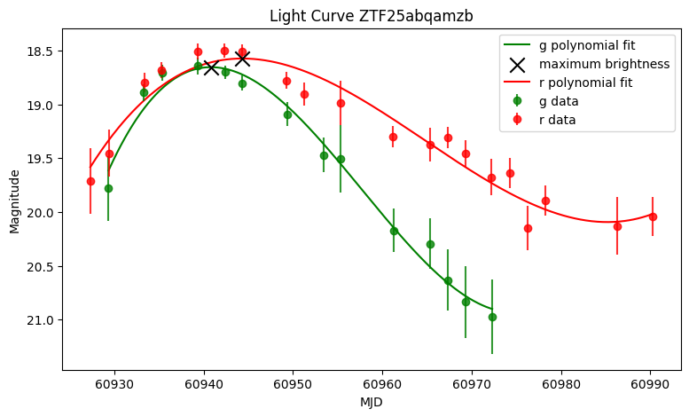
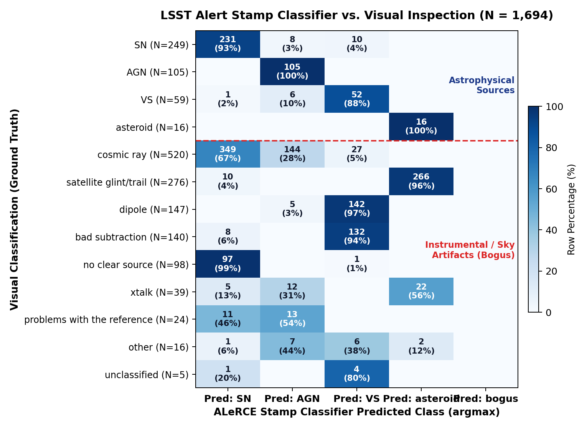
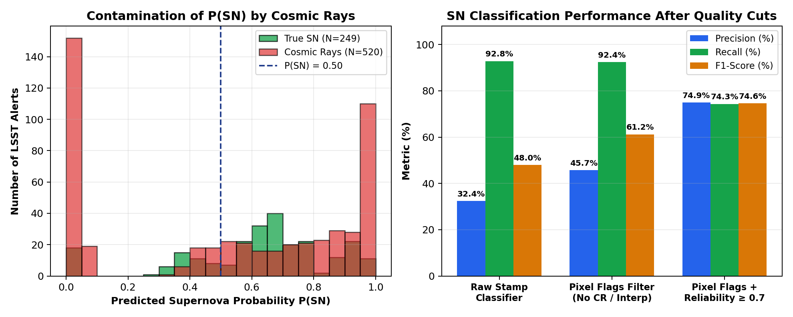

# ALeRCE-SNHunter: ZTF & LSST Supernova Candidate Pipeline

_Cross-matching ZTF forced-photometry Type Ia Supernova candidates with TNS and benchmarking the ALeRCE Stamp Classifier against visual inspection on early Vera C. Rubin Observatory (LSST) alerts._

> This project was developed during the **ALeRCE Hackathon 2026** (Millennium Institute of Astrophysics & Data Observatory, Chile).

**Authors:**

- [(@jurados)](https://github.com/jurados) **Steve Jurado** (_Main Contributor_), Universidad de Chile, Chile.
- [(@Xavissss)](https://github.com/Xavissss) **Xaviera Julio**, Chile.

**Visual Stamp Labeling & Scientific Dataset:** Prof. **Francisco Förster**, Universidad de Chile / Millennium Institute of Astrophysics (MAS) / ALeRCE.

---

## Introduction

Wide-field time-domain surveys such as the **Zwicky Transient Facility** (ZTF; Bellm et al., 2019) and the **Vera C. Rubin Observatory Legacy Survey of Space and Time** (LSST; Ivezić et al., 2019) generate hundreds of thousands to millions of difference-imaging alerts every night. Astronomical alert brokers such as **ALeRCE** (_Automatic Learning for the Rapid Classification of Events_; Förster et al., 2021) ingest these real-time streams and apply machine-learning classifiers at two complementary stages:

1. **Early Stamp Classification (Single-Epoch Cutouts):** Within minutes of an alert, Convolutional Neural Networks (Carrasco-Davis et al., 2021) classify the $63\times63$ pixel science, reference, and difference cutouts into five broad macro-classes: **Supernovae (`SN`)**, **Active Galactic Nuclei (`AGN`)**, **Variable Stars (`VS`)**, **Solar System (`asteroid`)**, and **Artifacts (`bogus`)**.
2. **Light-Curve Classification (Multi-Epoch Forced Photometry):** As detections accumulate in $g$, $r$, and $i$ bands, a Balanced Hierarchical Random Forest (`lc_classifier_BHRF_forced_phot`; Sánchez-Sáez et al., 2021) extracts parametric and stochastic features to classify transients into physical sub-types such as **Type Ia Supernovae (`SNIa`)**.

In practice, two operational bottlenecks arise when building pure, spectroscopically contextualized Supernova samples from broker streams:

- **Photometric-to-Spectroscopic Context Gap (ZTF $\leftrightarrow$ TNS):** Broker light-curve queries return high-probability `SNIa` candidates ($P(\text{SNIa}) \ge 0.59$), but lack confirmed spectroscopic redshifts ($z$), official IAU designations, and peak-epoch ($t_{\max}$) estimates required for cosmological and spectral modeling.
- **Instrumental Artifact Contamination in Early LSST Alerts:** During early commissioning and operations of new wide-field cameras, real astrophysical transients are heavily outnumbered by unmodeled instrumental and sky artifacts—cosmic rays, satellite glints/trails, astrometric dipoles, crosstalk (`xtalk`), and reference subtraction defects—that can deceive a 5-class Stamp Classifier trained on another survey or synthetic priors.

---

## Objective

1. **Automated ZTF `SNIa` Discovery & TNS Cross-Matching (`ZTF_candidates.ipynb`):** Query high-probability ZTF forced-photometry Type Ia Supernova candidates via the ALeRCE API, perform spherical sky cross-matching against the **Transient Name Server (TNS)** to recover spectroscopic redshifts ($z$), download multi-band light curves, and estimate peak magnitudes ($m_{\max}$) via polynomial fitting.
2. **LSST Stamp Classifier Benchmarking & Artifact Filtering (`classification_FF_20260309.csv`):** Evaluate the ALeRCE 5-class Stamp Classifier against **1,694 visually classified LSST alerts** spanning 13 fine-grained astrophysical and artifact categories, quantify contamination modes, and design pipeline quality cuts (`pixelflags` + `reliability`) to maximize `SN` purity.

---

## Dataset

This repository combines two datasets from the ZTF and LSST alert streams:

### 1. ZTF Forced-Photometry `SNIa` Candidates (`ZTF_candidates.ipynb`)

 queried directly through the `alerce` Python client (`classifier="lc_classifier_BHRF_forced_phot"`, `class_name="SNIa"`) for recent alerts with $\text{MJD}_{\text{last}} \ge 60918$ (September 1, 2025) and classification probability $P(\text{SNIa}) \ge 0.59$:

| Dataset Stage | Selection Criterion | Objects ($N$) | Total Detections |
| :--- | :--- | ---: | ---: |
| **ALeRCE ZTF Query** | `lc_classifier_BHRF_forced_phot` ($P_{\text{SNIa}} \ge 0.59$, $\text{MJD} \ge 60918$) | 129 | 5,903 |
| **TNS Sky Cross-Match** | Angular separation $\Delta\theta \le 2.0''$ against `tns_public_objects.csv` | 129 | 5,903 |
| **Spectroscopic Redshift Subset** | Valid spectroscopic $z$ reported in TNS | 119 | 5,480 |

### 2. Visually Classified LSST Alert Stream (`classification_FF_20260309.csv`)

A benchmark catalog of **1,694 LSST difference-image alerts** (108 columns per alert, including PSF/aperture/trail/dipole fluxes, quadrupole shape moments $I_{xx}, I_{yy}, I_{xy}$, pixel flags, `extendedness`, `reliability`, human `visual_classification`, and ALeRCE Stamp Classifier probabilities `AGN_prob`, `SN_prob`, `VS_prob`, `asteroid_prob`, `bogus_prob`).

| Category Type | Visual Classification (`visual_classification`) | Alerts ($N$) | Fraction (%) |
| :--- | :--- | ---: | ---: |
| **Astrophysical Sources** | **Supernova (`SN`)** | **249** | **14.7%** |
| | Active Galactic Nucleus (`AGN`) | 105 | 6.2% |
| | Variable Star (`VS`) | 59 | 3.5% |
| | Solar System (`asteroid`) | 16 | 0.9% |
| **Instrumental / Sky Artifacts** | Cosmic Ray (`cosmic ray`) | 520 | 30.7% |
| | Satellite Glint / Trail (`satellite glint/trail`) | 276 | 16.3% |
| | Astrometric Dipole (`dipole`) | 147 | 8.7% |
| | Bad Subtraction (`bad subtraction`) | 140 | 8.3% |
| | No Clear Source / Noise (`no clear source`) | 98 | 5.8% |
| | Detector Crosstalk (`xtalk`) | 39 | 2.3% |
| | Reference Image Defect (`problems with the reference`) | 24 | 1.4% |
| **Ambiguous** | `other` / `unclassified` | 21 | 1.2% |
| **Total** | | **1,694** | **100.0%** |

---

## Methodology

### 1. Spherical Cross-Matching Between ALeRCE and TNS

For each ZTF candidate $i$ with mean coordinates $(\alpha_i, \delta_i)$ (`meanra`, `meandec`) and each TNS entry $j$ at $(\alpha_j, \delta_j)$, we compute the exact great-circle angular separation $\Delta\theta_{ij}$ using `astropy.coordinates.SkyCoord.match_to_catalog_sky`:

$$\cos(\Delta\theta_{ij}) = \sin\delta_i \sin\delta_j + \cos\delta_i \cos\delta_j \cos(\alpha_i - \alpha_j)$$

A candidate is matched to its nearest TNS counterpart if:

$$\Delta\theta_{\min, i} = \min_j \Delta\theta_{ij} \le 2.0''$$

### 2. Multi-Band Peak Estimation & Photometric Transformations

For each candidate's multi-band light curve in ZTF $g$ (`fid = 1`) and $r$ (`fid = 2`) bands, we model the apparent PSF magnitude $m_\lambda(t)$ around maximum light using a cubic polynomial of degree $d = 3$ via least-squares regression:

$$\hat{m}_\lambda(t) = \sum_{k=0}^{3} c_{\lambda, k}\, t^k, \qquad t_{\max, \lambda} = \arg\min_{t \in [t_{\min}, t_{\max}]} \hat{m}_\lambda(t)$$

To compare ZTF $(g, r)$ photometry against Johnson-Cousins $(B, V)$ templates, we apply the linear color transformations:

$$V = r + 0.44(g - r) - 0.02, \qquad B = r + 1.48(g - r) + 0.17$$

### 3. LSST Stamp Classifier Evaluation & Pipeline Quality Cuts

For each LSST alert $n \in \{1, \dots, 1694\}$, the Stamp Classifier outputs a probability simplex $\mathbf{p}_n = (p_{\text{AGN}}, p_{\text{SN}}, p_{\text{VS}}, p_{\text{asteroid}}, p_{\text{bogus}})$ with $\sum_{c} p_{n,c} = 1$. The raw predicted class is:

$$\hat{y}_n = \arg\max_{c \in \{\text{AGN}, \text{SN}, \text{VS}, \text{asteroid}, \text{bogus}\}} p_{n, c}$$

To suppress false positives caused by unflagged cosmic rays and subtraction artifacts in the `SN` channel, we evaluate two progressive post-classification quality cuts using LSST `diaSource` metadata:

1. **Pixel-Flag Filter:** Reject alerts with cosmic-ray or interpolated pixel flags (`pixelflags_cr == False` and `pixelflags_interpolated == False`).
2. **Reliability + Pixel-Flag Filter:** Additionally require a real-bogus pipeline reliability score $\text{reliability} \ge 0.70$.

---

## Results

### 1. ZTF `SNIa` Light-Curve Recovery & Polynomial Peak Fitting

All **129** ZTF `SNIa` candidates ($\text{MJD}_{\text{last}} \ge 60918$, $P_{\text{SNIa}} \ge 0.59$) matched a known transient within $\Delta\theta \le 2.0''$ in TNS, yielding **119 spectroscopically confirmed redshifts** and **5,903 total photometric detections**. Below is the polynomial peak reconstruction for the case-study Type Ia candidate **`ZTF25abqamzb`** (34 detections in ZTF $g$ and $r$):

  

### 2. LSST Stamp Classifier vs. Visual Inspection (1,694 Alerts)

Comparing the Stamp Classifier's $\arg\max$ prediction against the 13 visual ground-truth categories reveals high sensitivity to genuine astrophysical sources, but specific failure modes when confronted with instrumental artifacts:

  

- **High Recall on Real Astrophysical Sources:**
  - **Supernovae (`SN`):** **231 / 249 (92.8%)** are correctly classified as `SN` (only 10 are confused with `VS` and 8 with `AGN`).
  - **Active Galactic Nuclei (`AGN`):** **105 / 105 (100.0%)** are correctly recovered.
  - **Asteroids (`asteroid`):** **16 / 16 (100.0%)** are correctly recovered.
  - **Variable Stars (`VS`):** **52 / 59 (88.1%)** are correctly recovered.
- **Structured Artifact Confusion Patterns:**
  - **Cosmic Rays ($N = 520$) $\to$ `SN` / `AGN`:** **349 (67.1%)** cosmic rays are misclassified as `SN` and **144 (27.7%)** as `AGN`, making cosmic rays the single largest source of false Supernova alerts.
  - **Satellite Glints/Trails ($N = 276$) $\to$ `asteroid`:** **266 (96.4%)** are misclassified as Solar System asteroids because their elongated trail morphology mimics fast-moving point sources.
  - **Dipoles ($N = 147$) & Bad Subtractions ($N = 140$) $\to$ `VS`:** **96.6%** of dipoles and **94.3%** of bad subtractions are assigned to `VS`.
  - **Empty / Noise Cutouts (`no clear source`, $N = 98$) $\to$ `SN`:** **97 (99.0%)** default to `SN`.

### 3. Impact of LSST Quality Cuts on `SN` Precision and Recall

Evaluating binary Supernova classification (`SN` vs. all other classes) across the 1,694 alerts demonstrates the effectiveness of combining the Stamp Classifier with LSST `diaSource` flags:

| Filtering Strategy | TP | FP | FN | TN | Precision | Recall | F1-Score | FP Reduction |
| :--- | ---: | ---: | ---: | ---: | ---: | ---: | ---: | ---: |
| **1. Raw Stamp Classifier ($\hat{y} = \text{SN}$)** | **231** | 483 | **18** | 962 | 0.324 | **0.928** | 0.480 | — |
| **2. + Pixel Flags (`!cr` & `!interp`)** | 230 | 273 | 19 | 1,172 | 0.457 | 0.924 | 0.612 | $-43.5\%$ |
| **3. + Pixel Flags & `reliability >= 0.70`** | 185 | **62** | 64 | **1,383** | **0.749** | 0.743 | **0.746** | **$-87.2\%$** |

  

---

## Conclusions

- **Automated ZTF + TNS pipeline:** Querying ALeRCE's `lc_classifier_BHRF_forced_phot` ($P_{\text{SNIa}} \ge 0.59$) and cross-matching within $2.0''$ against TNS provides a fast, zero-manual-vetting workflow to build spectroscopically anchored SN Ia light-curve samples (119 confirmed redshifts out of 129 candidates).
- **Strong astrophysical recall in early LSST stamps:** The ALeRCE Stamp Classifier generalizes with **92.8% recall on true LSST Supernovae** and **100% recall on AGNs and asteroids** even before full LSST survey retraining.
- **Artifact modes are morphological and predictable:** Unrejected artifacts do not scatter randomly across classes; cosmic rays and noise spikes systematically leak into `SN` (446 of the 483 false positives), satellite glints leak into `asteroid` (96.4%), and dipoles/bad subtractions leak into `VS` (>94%).
- **Metadata quality cuts double `SN` purity:** Filtering out `pixelflags_cr` and `pixelflags_interpolated` removes **43.5% of false Supernovae** while losing only **1 out of 231 true SNe** (Recall remains **92.4%**). Adding `reliability >= 0.70` eliminates **87.2% of false positives**, boosting `SN` Precision from **32.4% to 74.9%** and F1 from **0.480 to 0.746**.

---

## Future Work

- Retrain or fine-tune the Stamp Classifier's `bogus` head directly on the 1,244 visually labeled LSST artifacts (`cosmic ray`, `satellite glint/trail`, `dipole`, `bad subtraction`, `xtalk`) to natively suppress instrumental false positives.
- Build a hybrid tabular + CNN classifier that fuses the $63\times63$ image cutouts with LSST `diaSource` morphological flags (`extendedness`, `reliability`, `psfchi2`, quadrupole moments $I_{xx}, I_{yy}, I_{xy}$).
- Replace the cubic polynomial peak fit in `ZTF_candidates.ipynb` with physical light-curve fitters (**SALT2 / SALT3** via `sncosmo` and **SNooPy**) using the recovered TNS spectroscopic redshifts.

---

## References

- Bellm, E. C., Kulkarni, S. R., Graham, M. J., Dekany, R., Smith, R. M., Riddle, R., et al. (2019). The Zwicky Transient Facility: System Overview, Performance, and First Results. _Publications of the Astronomical Society of the Pacific_, 131(995), 018002. https://doi.org/10.1088/1538-3873/aaecbe

- Carrasco-Davis, R., Reyes, E., Valenzuela, C., Förster, F., Estévez, P. A., Pignata, G., et al. (2021). Alert Classification for the ALeRCE Broker System: The Real-time Stamp Classifier. _The Astronomical Journal_, 162(6), 231. https://doi.org/10.3847/1538-3881/ac0ef1

- Förster, F., Cabrera-Vives, G., Castillo-Navarrete, E., Estévez, P. A., Sánchez-Sáez, P., Arredondo, J., et al. (2021). The Automatic Learning for the Rapid Classification of Events (ALeRCE) Alert Broker. _The Astronomical Journal_, 161(5), 242. https://doi.org/10.3847/1538-3881/abe9bc

- Ivezić, Ž., Kahn, S. M., Tyson, J. A., Abel, B., Acosta, E., Allsman, R., et al. (2019). LSST: From Science Drivers to Reference Design and Anticipated Data Products. _The Astrophysical Journal_, 873(2), 111. https://doi.org/10.3847/1538-4357/ab042c

- Sánchez-Sáez, P., Reyes, I., Valenzuela, C., Förster, F., Eyheramendy, S., Elorrieta, F., et al. (2021). Alert Classification for the ALeRCE Broker System: The Light Curve Classifier. _The Astronomical Journal_, 161(3), 141. https://doi.org/10.3847/1538-3881/abd5c1

**Update Date**: November 2026.
