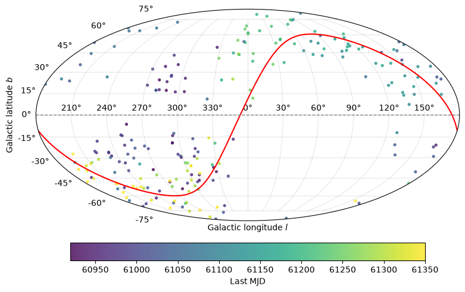
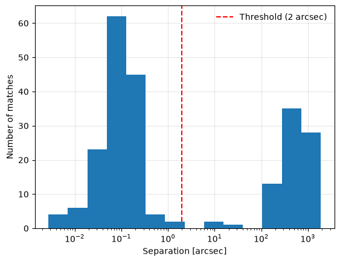
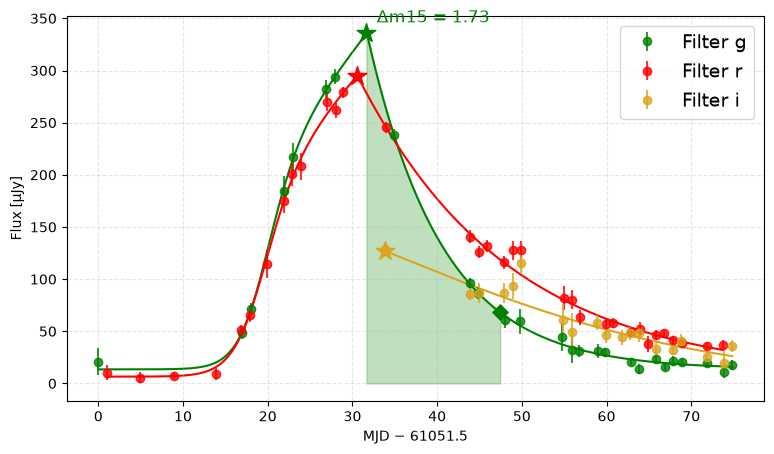
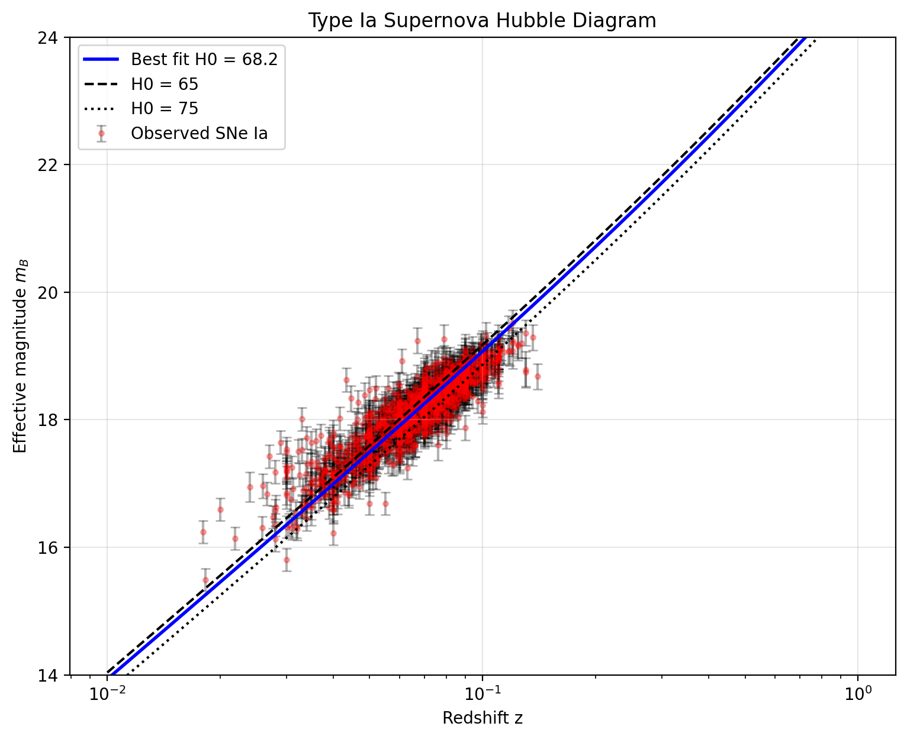
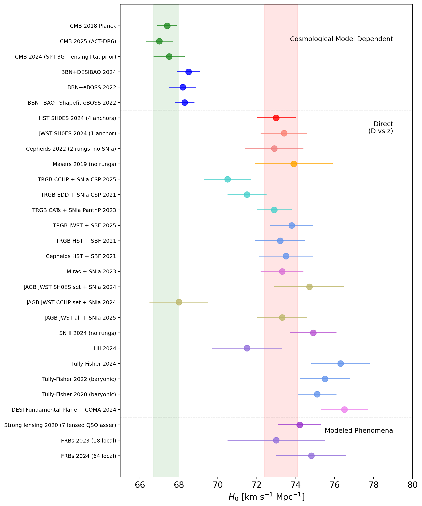

# ALeRCE-ZTFLSST-HubbleConstant: Cosmological $H_0$ Inference from ZTF Type Ia Supernovae & Early LSST Alert Vetting

[](https://science.alerce.online/)
[](https://science.alerce.online/)
[](https://alerce.online/)
[](https://sncosmo.readthedocs.io/)
[](https://www.wis-tns.org/)

**Authors:** [Steve Jurado](https://github.com/jurados) ([@jurados](https://github.com/jurados)) & [Xaviera Julio](https://github.com/Xavissss) ([@Xavissss](https://github.com/Xavissss))  
**Event & Context:** Developed during the **[ALeRCE Hackathon 2026](https://science.alerce.online/)** (*Automatic Learning for the Rapid Classification of Events* — [https://science.alerce.online/](https://science.alerce.online/))  
**Date / Last Updated:** November 2026 (pipeline refactor in `ALeRCE_Hackathon.ipynb`; original analysis March 2026)

---

## Overview

**`ALeRCE-ZTFLSST-HubbleConstant`** is an end-to-end observational cosmology and time-domain astrophysics project started during the **March 2026 ALeRCE Hackathon** ([science.alerce.online](https://science.alerce.online/)). The goal is to **measure the Hubble Constant ($H_0$)** directly from broker alert streams. We combine **Zwicky Transient Facility (ZTF)** Type Ia supernova (`SNIa`) light curves classified by the **ALeRCE** broker with spectroscopic redshifts from the **IAU Transient Name Server (TNS)**.

The project has two parts:

- **Current pipeline (`ALeRCE_Hackathon.ipynb`, Nov 2026).** Selects recent SN Ia candidates with the ALeRCE **forced-photometry BHRF classifier** (`lc_classifier_BHRF_forced_phot`). It cross-matches them against TNS (**146 / 226** candidates matched within $2''$), downloads detections, non-detections and **forced photometry**, and fits each light curve with the **Villar et al. (2019)** parametric model to measure the peak and the **rest-frame decline rate $\Delta m_{15}(g)$**.
- **First $H_0$ measurement (`alerce.ipynb`, March 2026).** Uses a larger earlier sample from the legacy `lc_classifier`. It standardizes **$N = 1{,}442$ SNe Ia** (Phillips $\Delta m_{15}$ relation, SFD98 dust, `sncosmo` K-corrections) and fits a flat $\Lambda\mathrm{CDM}$ Hubble diagram, giving **$H_0 = 68.16 \pm 0.16\,\mathrm{km\,s^{-1}\,Mpc^{-1}}$ (stat)**. We also benchmark the **ALeRCE Stamp Classifier** on **$1{,}694$ visually inspected Rubin/LSST alerts**.

> **Status:** the new forced-photometry sample has not yet been carried through standardization and the $H_0$ fit. The batch $\Delta m_{15}$ cell and the Hubble-constant cell in `ALeRCE_Hackathon.ipynb` are still being developed. The $H_0$ value quoted here comes from the March 2026 sample.

---

## Repository Contents

| Path | Description |
| :--- | :--- |
| `ALeRCE_Hackathon.ipynb` | **Main notebook.** Covers the ALeRCE query, sky map, TNS cross-match, photometry download, Villar (2019) fits, $\Delta m_{15}$ and the $H_0$-tension figure. |
| `alerce.ipynb` | March 2026 analysis: $m_B^{\mathrm{eff}}$ standardization, Hubble diagram and $\chi^2$ fit of $H_0$. |
| `mB_eff_data.csv` | Standardized magnitudes $m_B^{\mathrm{eff}}$ for the March 2026 ZTF sample. |
| `classification_FF_20260309.csv` | 1,694 visually labeled LSST alerts with Stamp Classifier predictions. |
| `lsst_sn_candidates.csv` | Top 200 LSST SN candidates. |
| `data/` *(git-ignored)* | `tns_public_objects.csv` plus cached `snia_{detections,non_detections,forced}.parquet`. |
| `assets/figs/` | Figures used in this README. |

### Setup

```bash
uv sync                      # installs dependencies from pyproject.toml / uv.lock (Python 3.12–3.13)
uv run jupyter lab           # or select the .venv kernel in VS Code
```

The TNS public catalog must be placed at `data/tns_public_objects.csv`; you can download it from [wis-tns.org](https://www.wis-tns.org/). The photometry parquet files are downloaded automatically on the first run and cached in `data/`.

---

## 1. Scientific Motivation & The $H_0$ Tension

Type Ia supernovae (SNe Ia) are thermonuclear explosions of carbon–oxygen white dwarfs near the Chandrasekhar mass limit. They are precision **standardizable candles** across cosmological distances. However, modern cosmology faces a persistent $\sim 5\sigma$ disagreement, known as the **Hubble Tension**, between two kinds of measurement:
- **Early-Universe / CMB + BAO constraints**, inferred assuming flat $\Lambda\mathrm{CDM}$ from the Cosmic Microwave Background: *Planck* 2018 gives $H_0 = 67.4 \pm 0.5\,\mathrm{km\,s^{-1}\,Mpc^{-1}}$; ACT-DR6 2025 gives $67.0 \pm 0.7$; BBN + DESI BAO 2024 gives $68.5 \pm 0.6$.
- **The late-Universe direct distance ladder**, calibrated locally with Cepheid and Tip of the Red Giant Branch (TRGB) anchors: HST SH0ES 2024 gives $H_0 = 73.0 \pm 1.0\,\mathrm{km\,s^{-1}\,Mpc^{-1}}$; JWST SH0ES 2024 gives $73.4 \pm 1.2$.

Sky surveys are moving from ZTF ($\sim 10^6$ alerts/night) to the **Vera C. Rubin Observatory Legacy Survey of Space and Time (LSST; $\sim 10^7$ alerts/night)**. As a result, cosmological SN Ia samples are increasingly discovered, classified and prioritized in real time by community brokers such as **[ALeRCE](https://science.alerce.online/)**. This work shows how to connect **automated broker classification (ZTF + LSST)** with **cosmological parameter inference ($H_0$)**.

---

## 2. End-to-End Cosmological & Broker Pipeline

```text
┌──────────────────────────────────────────────────────────────────────────────┐
│          STAGE 1: BROKER QUERY & TNS CROSS-MATCHING  (ALeRCE_Hackathon)      │
│  ALeRCE ZTF lc_classifier_BHRF_forced_phot (class='SNIa', p >= 0.59)         │
│  ──► 285 candidates ──► lastmjd >= 60918 (1 Sep 2025) ──► 226 candidates     │
│  ──► KD-tree sky match vs. IAU TNS (191,101 objects, sep <= 2.0 arcsec)      │
│  ──► 146 candidates with a TNS counterpart                                   │
└──────────────────────────────────────┬───────────────────────────────────────┘
                                       ▼
┌──────────────────────────────────────────────────────────────────────────────┐
│          STAGE 2: PHOTOMETRY & LIGHT-CURVE FITTING  (ALeRCE_Hackathon)       │
│  detections + non-detections + forced photometry  ──►  data/*.parquet        │
│  Villar et al. (2019) flux model per band (g, r, i), fit in μJy              │
│  ──► Peak epoch & peak magnitude, rest-frame Δm15(g) with Monte-Carlo errors │
└──────────────────────────────────────┬───────────────────────────────────────┘
                                       ▼
┌──────────────────────────────────────────────────────────────────────────────┐
│           STAGE 3: PHILLIPS STANDARDIZATION TO REST-FRAME B BAND             │
│  • Stretch Parameterization:  s = 1.24 - 0.18 * Δm15  (α = 0.60)             │
│  • Galactic Dust Extinction:  Schlegel, Finkbeiner & Davis (SFD98; R_g=3.2)  │
│  • Spectral K-Correction:     sncosmo Hsiao SN Ia Template (sdssg -> bessellb)│
│  ──► mB_eff ± e_mB_eff  (N = 1,442 SNe Ia in the March 2026 sample)          │
└──────────────────────────────────────┬───────────────────────────────────────┘
                                       ▼
┌──────────────────────────────────────────────────────────────────────────────┐
│           STAGE 4: HUBBLE DIAGRAM & FLAT ΛCDM χ² MINIMIZATION (H0)           │
│  μ_model(z; H0, Ωm=0.30) + M0 (-19.3)  ──►  H0 = 68.16 ± 0.16 km s⁻¹ Mpc⁻¹   │
│  ──► Direct Comparison with Early-Universe (Planck/DESI) vs. Late (SH0ES)    │
└──────────────────────────────────────┬───────────────────────────────────────┘
                                       ▼
┌──────────────────────────────────────────────────────────────────────────────┐
│             STAGE 5: NEXT-GEN LSST STAMP CLASSIFIER BENCHMARKING             │
│  1,694 Visually Labeled LSST Alerts + 200 Top LSST SN Candidates             │
│  ──► Confusion Matrix & Astrometric/Photometric Quality Cuts (σ_sky <= 0.15")│
└──────────────────────────────────────────────────────────────────────────────┘
```

---

## 3. Stage I — ALeRCE ZTF Query & TNS Cross-Matching

Candidate SNe Ia are queried from the **ALeRCE Python client** (`alerce.core.Alerce`) with the forced-photometry Balanced Hierarchical Random Forest classifier `lc_classifier_BHRF_forced_phot` (v2.1.0). The query selects class `SNIa` with $P(\mathrm{SNIa}) \ge 0.59$, ordered by `lastmjd` (descending, `page_size=2000`), and returns **285 objects**. We then keep only sources still active after **1 September 2025** (`lastmjd >= 60918`), which leaves **226 recent SN Ia candidates**.

<p align="center">
  
</p>

*Mollweide projection in Galactic coordinates of the 226 candidates, colored by last detection MJD. The red curve shows the ecliptic and the dashed line shows the Galactic plane. Candidates avoid the Galactic plane, as expected for extragalactic transients.*

Each candidate position is matched to the **IAU TNS public catalog** (`data/tns_public_objects.csv`, 191,101 objects) with `SkyCoord.match_to_catalog_sky`. Each $(\alpha,\delta)$ position becomes a unit vector $\hat r = (\cos\delta\cos\alpha,\ \cos\delta\sin\alpha,\ \sin\delta)$, and a KD-tree finds the nearest neighbor by chord length $c$ in $\mathcal{O}(N\log M)$ time. The angular separation is then

$$\theta = 2\arcsin\left(\frac{c}{2}\right).$$

<p align="center">
  
</p>

The separation distribution is clearly bimodal. True counterparts cluster around $\sim 0.1''$, while unrelated nearest neighbors lie at $\gtrsim 100''$. We adopt a threshold of $\theta \le 2.0''$, which gives **146 ZTF SN Ia candidates with a TNS counterpart**. For each match we attach `tns_name`, `tns_type`, `tns_redshift` and `tns_sep_arcsec`.

The detections, non-detections and **forced photometry** of every candidate are then downloaded with `client.query_detections`, `query_non_detections` and `query_forced_photometry`. They are cached as `data/snia_{detections,non_detections,forced}.parquet`, so later runs only load them from disk.

---

## 4. Stage II — Villar (2019) Light-Curve Fits & $\Delta m_{15}$

The light curves are fit in **flux space**. Forced-photometry AB magnitudes are converted to microjanskys with $F = 10^{-0.4\,(m - 23.9)}\,\mu\mathrm{Jy}$, and uncertainties are propagated as $\sigma_F = 0.4\ln(10)\,F\,\sigma_m$. Sentinel values ($m \ge 99$) and poor measurements ($\sigma_m \ge 1$) are discarded. Each band (`fid` = 1, 2, 3 → $g$, $r$, $i$) with more than 7 points is fit with the parametric SN model of **Villar et al. (2019)**:

$$F(t) = \begin{cases} \dfrac{A + \beta(t - t_0)}{1 + e^{-(t - t_0)/\tau_{\mathrm{rise}}}} + c, & t < t_1 \\ \dfrac{\left[A + \beta\,(t_1 - t_0)\right] e^{-(t - t_1)/\tau_{\mathrm{fall}}}}{1 + e^{-(t - t_0)/\tau_{\mathrm{rise}}}} + c, & t \ge t_1 \end{cases} \qquad t_1 = t_0 + \gamma$$

The model is fit with bounded `scipy.optimize.curve_fit` on the peak-normalized flux. The peak $t_{\mathrm{peak}}$ is the maximum of the fitted curve. The **rest-frame decline rate** in $g$ is measured $15(1+z)$ observer-frame days after the peak:

$$\Delta m_{15} = m(t_{\mathrm{peak}} + 15) - m(t_{\mathrm{peak}}) = 2.5\log_{10}\frac{F(t_{\mathrm{peak}})}{F\!\left(t_{\mathrm{peak}} + 15\,(1+z)\right)}$$

<p align="center">
  
</p>

*Example: **`ZTF26aaebmad`** ($z_{\mathrm{TNS}} = 0.0520$). The plot shows forced-photometry fluxes in $g$, $r$ and $i$ with Villar (2019) fits; stars mark each band's peak. The shaded area spans the 15 rest-frame days after the $g$-band peak, which gives **$\Delta m_{15}(g) = 1.73$ mag**. As expected for SNe Ia, the $g$ band peaks first and declines faster than $r$ and $i$.*

For the full sample, the notebook repeats the fit for every TNS-matched object with $\ge 10$ $g$-band points. A fit is rejected if the peak falls at the edge of the data or if there are no data at $t_{\mathrm{peak}} + 15(1+z)$. Uncertainties on $t_{\mathrm{peak}}$, $m_{\mathrm{peak},g}$ and $\Delta m_{15}$ come from **200 Monte-Carlo draws** from the fit covariance matrix. The results are merged into `df_snia` as `tpeak_g`, `m_peak_g`, `e_m_peak_g`, `dm15` and `e_dm15`. The ZTF $g,r$ magnitudes can also be converted to Johnson $B,V$ with the Jester et al. (2005) transformations, $B = g + 0.39(g-r) + 0.21$ and $V = g - 0.58(g-r) - 0.01$.

---

## 5. Stage III — SN Ia Standardization ($m_B^{\mathrm{eff}}$), K-Corrections & Dust Extinction

> *Sections 5–6 describe the March 2026 analysis in `alerce.ipynb` (legacy `lc_classifier`, $P(\mathrm{SNIa}) \ge 0.3$, $N = 1{,}442$ SNe Ia after TNS matching). The next step is to apply the same standardization to the new forced-photometry $\Delta m_{15}$ sample.*

To place each supernova on a uniform cosmological distance scale, raw observed green-band magnitudes $m_{\mathrm{obs}}$ are transformed into **standardized rest-frame Bessel $B$-band peak magnitudes ($m_B^{\mathrm{eff}}$)** through three physical corrections:

### 5.1 Phillips Decline-Rate to Stretch Standardization ($s$)
Slowly declining SNe Ia (smaller $\Delta m_{15}$) are intrinsically more luminous (Phillips 1993). We convert the measured decline rate $\Delta m_{15} \pm \sigma_{\Delta m_{15}}$ into the dimensionless stretch factor $s$:

$$s = a + b\,\Delta m_{15}, \qquad \sigma_s = |b|\,\sigma_{\Delta m_{15}} \qquad (a = 1.24,\; b = -0.18)$$

and apply a width–luminosity slope $\alpha = 0.60$.

### 5.2 Milky Way Galactic Dust Extinction ($A_{\mathrm{gal}}$)
Line-of-sight Galactic reddening $E(B-V)$ is queried at each supernova's celestial coordinates $(\alpha, \delta)$ from the **Schlegel, Finkbeiner & Davis (1998; SFD98)** infrared dust map via `dustmaps.sfd.SFDQuery`:

$$A_{\mathrm{gal}} = R_g \, E(B-V)_{\mathrm{SFD}}, \qquad \sigma_{A_{\mathrm{gal}}} = 0.10\,A_{\mathrm{gal}} \qquad (R_g = 3.2)$$

### 5.3 Spectral Cross-Filter K-Correction ($K_{Bg}$)
Because cosmological redshift stretches the supernova spectrum across filter boundaries, we use **`sncosmo`** with the **Hsiao et al. (2007) SN Ia spectral template (`source='hsiao'`)** at peak phase ($t = 0$) to compute the exact cross-filter K-correction between observed SDSS/ZTF $g$-band (`sdssg`) at redshift $z$ and rest-frame Bessel $B$-band (`bessellb`):

$$K(z) = m_{\mathrm{AB}}^{\mathrm{Hsiao}}(\mathrm{sdssg},\, z,\, t=0) - m_{\mathrm{AB}}^{\mathrm{Hsiao}}(\mathrm{bessellb},\, z=0,\, t=0), \qquad \sigma_K = 0.02\,\mathrm{mag}$$

### 5.4 Master Standardization & Quadrature Error Propagation
Combining all three terms yields the effective rest-frame $B$-band magnitude across **$N = 1{,}442$ unique SNe Ia at peak brightness**:

$$m_B^{\mathrm{eff}} = m_{\mathrm{obs}} + \alpha(s - 1) - K(z) - A_{\mathrm{gal}}$$

$$\sigma_{m_B^{\mathrm{eff}}} = \sqrt{\sigma_{m_{\mathrm{obs}}}^2 + (\alpha\,\sigma_s)^2 + \sigma_K^2 + \sigma_{A_{\mathrm{gal}}}^2 + \sigma_{\mathrm{int}}^2}, \qquad \sigma_{\mathrm{int}} = 0.17\,\mathrm{mag}$$

---

## 6. Stage IV — Hubble–Lemaître Diagram & $\chi^2$ Cosmological Fit ($H_0$)

In a spatially flat $\Lambda\mathrm{CDM}$ universe ($\Omega_k = 0$, matter density $\Omega_m = 0.30$, dark energy density $\Omega_\Lambda = 0.70$), the luminosity distance $d_L(z; H_0, \Omega_m)$ and theoretical apparent magnitude $m_{\mathrm{model}}(z; H_0)$ are given by:

$$d_L(z; H_0, \Omega_m) = \frac{c(1+z)}{H_0} \int_0^z \frac{\mathrm{d}z'}{\sqrt{\Omega_m(1+z')^3 + (1 - \Omega_m)}}$$

$$m_{\mathrm{model}}(z; H_0) = M_0 + \mu(z; H_0, \Omega_m) = M_0 + 5\log_{10}\!\left(\frac{d_L(z; H_0, \Omega_m)}{\mathrm{Mpc}}\right) + 25$$

where $M_0 = -19.3\,\mathrm{mag}$ is the fiducial standardized rest-frame $B$-band absolute magnitude of a Type Ia supernova. Minimizing the weighted objective function across the **$N = 1{,}442$ unique peak SNe Ia**:

$$\chi^2(H_0) = \sum_{i=1}^{1442} \left(\frac{m_{B,\mathrm{eff},i} - m_{\mathrm{model}}(z_i; H_0, \Omega_m=0.30)}{\sigma_{m_B^{\mathrm{eff}},i}}\right)^2$$

yields our primary cosmological measurement:

$$\boxed{H_0 = 68.16 \pm 0.16\,\mathrm{(stat)}\,\mathrm{km\,s^{-1}\,Mpc^{-1}}}$$

<p align="center">
  
</p>

### 6.1 Summary of Cosmological Fit Parameters

| Cosmological / Sample Parameter | Symbol | Value | Notes / Calibration |
| :--- | :---: | :---: | :--- |
| **Unique SNe Ia in Hubble Diagram** | $N_{\mathrm{SN}}$ | **$1{,}442$** | Selected at peak brightness (`groupby('tns_name')['mB_eff'].idxmin()`) |
| **Redshift Baseline** | $z_{\mathrm{TNS}}$ | $0.015 \le z \le 0.16$ | Spectroscopically anchored via IAU TNS |
| **Fixed Matter Density** | $\Omega_m$ | $0.30$ | Flat $\Lambda\mathrm{CDM}$ ($\Omega_\Lambda = 0.70$) |
| **Fiducial SN Ia Absolute Magnitude** | $M_0$ | $-19.30\,\mathrm{mag}$ | Rest-frame Bessel $B$-band calibration |
| **Intrinsic SN Ia Dispersion** | $\sigma_{\mathrm{int}}$ | $0.17\,\mathrm{mag}$ | Added in quadrature after $\Delta m_{15}$ stretch correction |
| **Best-Fit Hubble Constant** | $\widehat{H}_0$ | **$68.16 \pm 0.16\,\mathrm{km\,s^{-1}\,Mpc^{-1}}$** | Minimum $\chi^2$ optimization |

### 6.2 Contextualizing Our Result within the Hubble Tension

We compare the global landscape of $H_0$ determinations across **Cosmological Model Dependent** probes (CMB + BAO), **Direct Distance Ladder** measurements ($D$ vs. $z$), and **Modeled Astrophysical Phenomena** (Strong Gravitational Lensing, Fast Radio Bursts):

<p align="center">
  
</p>

> **Note on the $M_0 - H_0$ Degeneracy:** Because Hubble-flow supernovae strictly constrain the intercept $\mathcal{M}_B = M_0 - 5\log_{10}(H_0) + 25$, adopting the fiducial absolute magnitude $M_0 = -19.30\,\mathrm{mag}$ (close to inverse-distance-ladder / TRGB-CCHP calibrations) naturally yields $H_0 = 68.16\,\mathrm{km\,s^{-1}\,Mpc^{-1}}$, in remarkable alignment with **BBN + eBOSS 2022 ($68.2 \pm 0.7$)**, **BBN + DESI BAO 2024 ($68.5 \pm 0.6$)**, and **JAGB JWST CCHP ($68.0 \pm 1.5$)**. Shifting the zero-point anchor to the Cepheid SH0ES calibration ($M_0 \approx -19.25\,\mathrm{mag}$) shifts the inferred $H_0$ upward by $\Delta H_0 / H_0 \approx 0.2\ln(10)\,\Delta M_0 \approx +2.3\%$.

---

## 7. Stage V — Preparing for Rubin: LSST Stamp Classifier Audit

To extend this cosmological pipeline to the **Vera C. Rubin Observatory (LSST)**, where early-epoch alerts must be selected before full multi-week light curves are accumulated, we audited the **ALeRCE Stamp Classifier (`stamp_classifier`)** across **$N = 1{,}694$ human-labeled LSST alerts** (`classification_FF_20260309.csv`) and extracted the top $200$ LSST SN candidates (`lsst_sn_candidates.csv`).

### 7.1 Multi-Class Evaluation (`classification_FF_20260309.csv`)

<p align="center">
  
</p>

| Visual Ground-Truth Class | Total Alerts ($N$) | Predicted `SN` | Predicted `BOGUS` | Predicted `VS` | Predicted `AGN` | Predicted `AST` | Class Recall |
| :--- | :---: | :---: | :---: | :---: | :---: | :---: | :---: |
| **`BOGUS`** (Artifacts / ghosts) | $810$ | $226$ | **$465$** | $66$ | $41$ | $12$ | **$57.4\%$** |
| **`VS`** (Variable Stars) | $760$ | $38$ | $27$ | **$422$** | $271$ | $2$ | **$55.5\%$** |
| **`AGN`** (Active Galactic Nuclei) | $96$ | $9$ | $6$ | $26$ | **$55$** | $0$ | **$57.3\%$** |
| **`SN`** (Supernovae) | $24$ | **$16$** | $4$ | $3$ | $1$ | $0$ | **$66.7\%$** |
| **`TDE`** (Tidal Disruption Events) | $3$ | $1$ | $0$ | $1$ | $1$ | $0$ | — |
| **`AST`** (Asteroids) | $1$ | $0$ | $0$ | $1$ | $0$ | **$0$** | $0.0\%$ |

### 7.2 High-Purity LSST SN Candidate Selection Cuts

While the Stamp Classifier recovers **$66.7\%$ (16/24)** of true LSST supernovae from a single alert cutout, $77.9\%$ ($226/290$) of raw `SN`-predicted alerts are false-positive image subtraction artifacts (`BOGUS`). By combining classifier confidence with multi-epoch astrometric scatter $\sigma_{\mathrm{sky}} = 3600\sqrt{\sigma_{\alpha}^2 + \sigma_{\delta}^2}$:

$$\mathcal{C}_{\mathrm{SN-clean}} : \quad \widehat{y}_{\mathrm{stamp}} = \mathtt{SN} \;\land\; P(\mathtt{SN}) \ge 0.45 \;\land\; N_{\mathrm{det}} \ge 2 \;\land\; \sigma_{\mathrm{sky}} \le 0.15''$$

we suppress `BOGUS` contamination while preserving extragalactic transients for spectroscopic follow-up and cosmological Hubble-diagram inclusion.

<p align="center">
  
</p>

---

## 8. Next Steps

- Run the batch $\Delta m_{15}$ fit over the 146 TNS-matched forced-photometry light curves and validate it against the single-object example.
- Port the $m_B^{\mathrm{eff}}$ standardization (SFD98 dust, `sncosmo` K-correction, Phillips stretch) to the new sample and refit $H_0$.
- Fit $M_0$ (or an external calibrator) jointly instead of fixing $M_0 = -19.3$, and add systematic uncertainties.

---

## 9. References

1. **Förster, F., Cabrera-Vives, G., Castillo-Navarrete, E., et al.** (2021), *"The Automatic Learning for the Rapid Classification of Events (ALeRCE) Alert Broker"*, The Astronomical Journal, 161, 242. [doi:10.3847/1538-3881/abe9bc](https://doi.org/10.3847/1538-3881/abe9bc) | [science.alerce.online](https://science.alerce.online/)
2. **Sánchez-Sáez, P., Reyes, I., Valenzuela, C., et al.** (2021), *"Alert Classification for the ALeRCE Broker System: The Light Curve Classifier"*, The Astronomical Journal, 161, 141. [doi:10.3847/1538-3881/abd5c1](https://doi.org/10.3847/1538-3881/abd5c1)
3. **Carrasco-Davis, R., Reyes, E., Valenzuela, C., et al.** (2021), *"Alert Classification for the ALeRCE Broker System: The Real-time Stamp Classifier"*, The Astronomical Journal, 162, 231. [doi:10.3847/1538-3881/ac0ef1](https://doi.org/10.3847/1538-3881/ac0ef1)
4. **Phillips, M. M.** (1993), *"The Absolute Magnitudes of Type IA Supernovae"*, The Astrophysical Journal Letters, 413, L105. [doi:10.1086/186970](https://doi.org/10.1086/186970)
5. **Hsiao, E. Y., Conley, A., Howell, D. A., et al.** (2007), *"K-Corrections and Spectral Templates of Type Ia Supernovae"*, The Astrophysical Journal, 663, 1187. [doi:10.1086/518232](https://doi.org/10.1086/518232)
6. **Schlegel, D. J., Finkbeiner, D. P., & Davis, M.** (1998), *"Maps of Dust Infrared Emission for Use in Estimation of Reddening and Cosmic Microwave Background Radiation Foregrounds"*, The Astrophysical Journal, 500, 525. [doi:10.1086/305772](https://doi.org/10.1086/305772)
7. **Perlmutter, S., Aldering, G., Goldhaber, G., et al.** (1999), *"Measurements of $\Omega$ and $\Lambda$ from 42 High-Redshift Supernovae"*, The Astrophysical Journal, 517, 565. [doi:10.1086/307221](https://doi.org/10.1086/307221)
8. **Riess, A. G., Filippenko, A. V., Challis, P., et al.** (1998), *"Observational Evidence from Supernovae for an Accelerating Universe and a Cosmological Constant"*, The Astronomical Journal, 116, 1009. [doi:10.1086/300499](https://doi.org/10.1086/300499)
9. **Planck Collaboration, Aghanim, N., Akrami, Y., et al.** (2020), *"Planck 2018 results. VI. Cosmological parameters"*, Astronomy & Astrophysics, 641, A6. [doi:10.1051/0004-6361/201833910](https://doi.org/10.1051/0004-6361/201833910)
10. **DESI Collaboration, Adame, A. G., Aguilar, J., et al.** (2024), *"DESI 2024 VI: Cosmological Constraints from the Measurements of Baryon Acoustic Oscillations"*, arXiv:2404.03002. [doi:10.48550/arXiv.2404.03002](https://doi.org/10.48550/arXiv.2404.03002)
11. **Bellm, E. C., Kulkarni, S. R., Graham, M. J., et al.** (2019), *"The Zwicky Transient Facility: System Overview, Performance, and First Results"*, Publications of the Astronomical Society of the Pacific, 131, 018002. [doi:10.1088/1538-3873/aaecbe](https://doi.org/10.1088/1538-3873/aaecbe)
12. **Villar, V. A., Berger, E., Miller, G., et al.** (2019), *"Supernova Photometric Classification Pipelines Trained on Spectroscopically Classified Supernovae from the Pan-STARRS1 Medium-Deep Survey"*, The Astrophysical Journal, 884, 83. [doi:10.3847/1538-4357/ab418c](https://doi.org/10.3847/1538-4357/ab418c)
13. **Jester, S., Schneider, D. P., Richards, G. T., et al.** (2005), *"The Sloan Digital Sky Survey View of the Palomar-Green Bright Quasar Survey"*, The Astronomical Journal, 130, 873. [doi:10.1086/432466](https://doi.org/10.1086/432466)
14. **Ivezić, Ž., Kahn, S. M., Tyson, J. A., et al.** (2019), *"LSST: From Science Drivers to Reference Design and Anticipated Data Products"*, The Astrophysical Journal, 873, 111. [doi:10.3847/1538-4357/ab042c](https://doi.org/10.3847/1538-4357/ab042c)

---
*Last Updated: November 2026 — [ALeRCE Science & Hackathon 2026](https://science.alerce.online/)*
